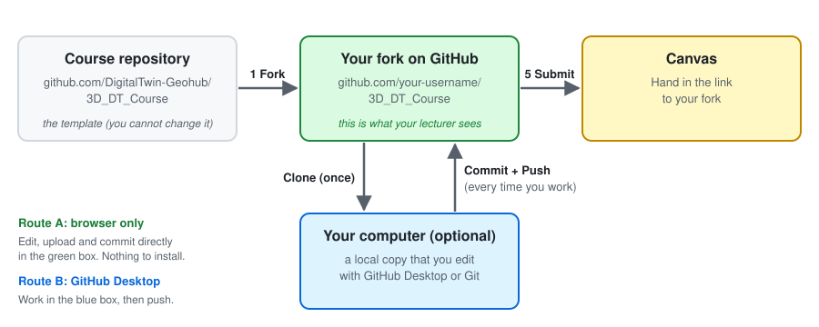
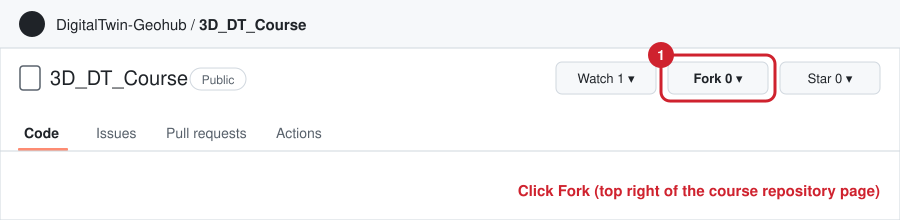
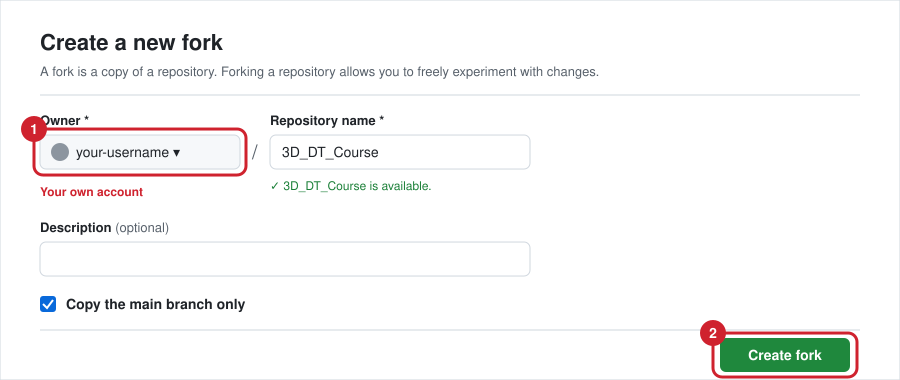
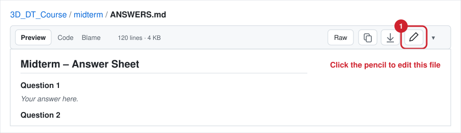
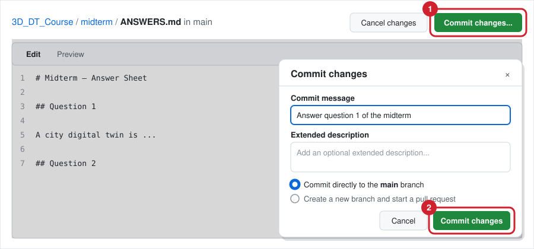
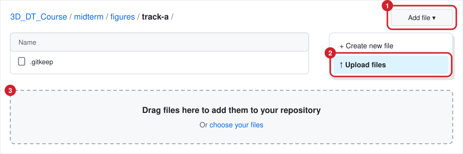
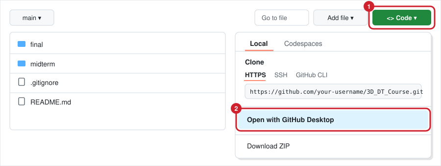
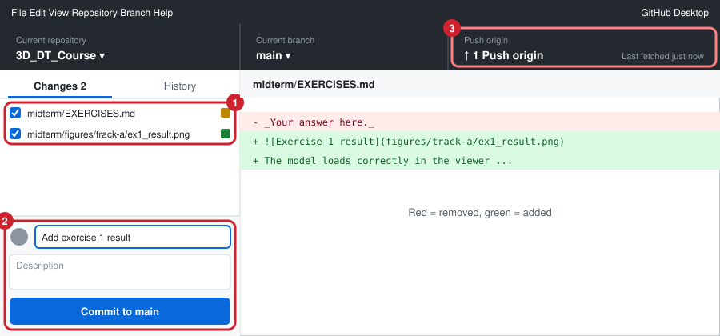
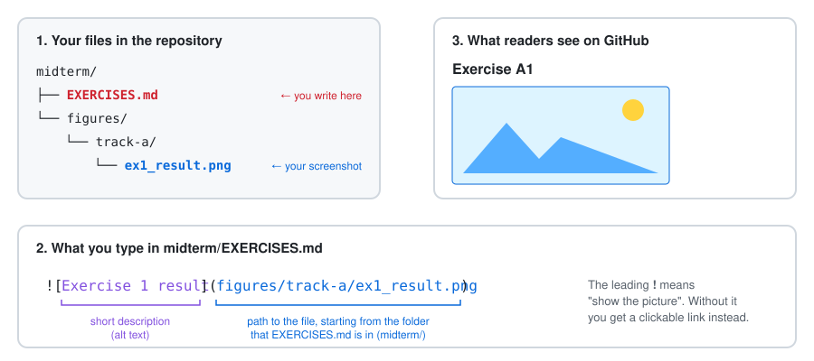
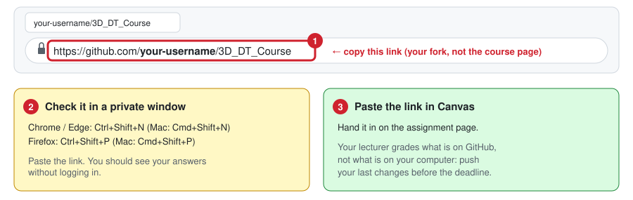

# Getting Started with GitHub

This guide is for students who have never used GitHub. It explains every step, from creating an account to handing in your link in Canvas. Setting up takes about 20 minutes. You only need a web browser. Installing software is optional.

> The pictures in this guide are simplified drawings of GitHub's screens. GitHub changes its look now and then, but the button names stay mostly the same. Look for the **red numbered markers**: they show what to click, in order.

## Contents

1. [The big picture](#the-big-picture)
2. [Step 0: Create a GitHub account](#step-0-create-a-github-account)
3. [Step 1: Fork the course repository](#step-1-fork-the-course-repository)
4. [Step 2: Choose how you want to work](#step-2-choose-how-you-want-to-work)
5. [Route A: Work in the browser](#route-a-work-in-the-browser)
6. [Route B: Work on your computer with GitHub Desktop](#route-b-work-on-your-computer-with-github-desktop)
7. [Step 3: Link and embed your files](#step-3-link-and-embed-your-files)
8. [Step 4: Commit and push regularly](#step-4-commit-and-push-regularly)
9. [Step 5: Submit your link in Canvas](#step-5-submit-your-link-in-canvas)
10. [Extra: Get updates from the course repository](#extra-get-updates-from-the-course-repository)
11. [Extra: Keep your work private](#extra-keep-your-work-private)
12. [Troubleshooting](#troubleshooting)

---

## The big picture

GitHub is a website that stores project folders online and remembers every version of every file. You will use it to hand in your assignments.



1. Your lecturer published an empty template: the **course repository**.
2. You make your own copy of it on GitHub: your **fork**.
3. You fill in your answers and add your files to your fork, either in the browser or on your computer.
4. You hand in the link to your fork in Canvas. Your lecturer opens that link to grade your work.

### Words you will see

| Word | What it means |
| --- | --- |
| **Repository** (or **repo**) | A project folder on GitHub, including the full history of every file. |
| **Fork** | Your own copy of someone else's repository, stored under your GitHub account. You can change your fork. You cannot change the original. |
| **Clone** | Downloading a repository to your computer so you can work on it there. Only needed for Route B. |
| **Commit** | Saving a snapshot of your changes, with a short message that says what you changed. GitHub keeps every commit, so you can always go back to an older version. |
| **Push** | Sending the commits you made on your computer up to GitHub. Only needed for Route B. In the browser, a commit is saved on GitHub straight away. |
| **Markdown** (`.md`) | A plain-text format for writing formatted text. All answer sheets in this repository are Markdown files. See [Step 3](#step-3-link-and-embed-your-files). |

> **Remember:** your lecturer only sees what is **on GitHub**. Work that is only on your computer, or that you did not commit, does not count.

---

## Step 0: Create a GitHub account

1. Go to [github.com/signup](https://github.com/signup).
2. Enter your email address, a password and a **username**.
   Your username will be part of the link you hand in (`github.com/your-username/...`), so choose one you are happy for your lecturer and future employers to see.
3. Confirm your email address. GitHub sends you a code or a link.

If you already have an account, log in and go to Step 1.

---

## Step 1: Fork the course repository

1. Log in to GitHub and open the course repository: <https://github.com/DigitalTwin-Geohub/3D_DT_Course>
2. Click **Fork** at the top right of the page.

   

3. On the **Create a new fork** page:
   1. Check that **Owner** shows your own username.
   2. Leave the repository name as it is, keep **Copy the main branch only** ticked, and click **Create fork**.

   

4. After a few seconds, GitHub opens your fork. Check the address bar: it should say `github.com/your-username/3D_DT_Course`, and under the name you should see *forked from DigitalTwin-Geohub/3D_DT_Course*.

**From now on, always work in your fork, never in the course repository.** Bookmark your fork so you can find it again. You can also find it by clicking your profile picture (top right) → **Your repositories**.

> A fork of this repository is **public**: anyone with the link can see it. If you need to keep your work private, for example because you use data you may not share, see [Keep your work private](#extra-keep-your-work-private) before you start.

---

## Step 2: Choose how you want to work

There are two ways to work. Both end up in the same place: your fork on GitHub. You can also mix them.

| | **Route A: in the browser** | **Route B: GitHub Desktop** |
| --- | --- | --- |
| Install anything? | No | Yes, the free [GitHub Desktop](https://desktop.github.com/) app |
| Good for | Writing answers, uploading screenshots, small files | Code, many files, large models, working offline |
| Largest file you can add | 25 MB per file | 100 MB per file |
| Suits | Midterm, Track A exercises | Track B exercises, final assignment |

If you are unsure, start with Route A. You can switch to Route B at any time.

---

## Route A: Work in the browser

### A1. Edit an answer sheet

1. In your fork, click the folder `midterm`, then the file `ANSWERS.md`.
2. Click the **pencil** icon at the top right of the file.

   

3. Replace each `_Your answer here._` with your answer. Click the **Preview** tab to see how your text will look.
4. When you are done, save your work by making a commit:
   1. Click **Commit changes...** at the top right.
   2. Write a short **commit message** that says what you did, e.g. `Answer question 1 of the midterm`. Keep **Commit directly to the main branch** selected, and click **Commit changes**.

   

Your changes are now saved on GitHub. Edit `README.md` the same way to fill in your name, student number and case study.

> **Tip:** the browser does not save drafts. If you write a long answer, write it in a text editor or Word first, or commit after each question, so you don't lose work if you close the tab.

### A2. Upload screenshots and other files

1. In your fork, open the folder where the file belongs, e.g. `midterm` → `figures` → `track-a`.
2. Click **Add file** → **Upload files**.
3. Drag your files onto the page, or click **choose your files**.

   

4. Scroll down, write a commit message such as `Add exercise 1 screenshot`, and click **Commit changes**.

Before you upload, give your files short names **without spaces**: `ex1_result.png`, not `Screenshot 2026-11-09 at 10.15.32.png`. That makes them much easier to link to in Step 3.

To upload a file into a folder that does not exist yet, use **Add file** → **Upload files** from the parent folder, and drag in the whole folder from your computer.

Now go to [Step 3](#step-3-link-and-embed-your-files) to show your files in your answer sheet.

---

## Route B: Work on your computer with GitHub Desktop

### B1. Install GitHub Desktop and sign in

1. Download and install [GitHub Desktop](https://desktop.github.com/).
2. Sign in with your GitHub account. If you skipped this when installing: **File** → **Options** → **Accounts** (Windows), or **GitHub Desktop** → **Settings** → **Accounts** (Mac).

### B2. Clone your fork (once)

1. Open **your fork** in the browser (`github.com/your-username/3D_DT_Course`).
2. Click the green **Code** button → **Open with GitHub Desktop**.

   

3. GitHub Desktop opens. Choose where to save the folder on your computer, e.g. `Documents\GitHub\3D_DT_Course`, and click **Clone**.
4. If GitHub Desktop asks *How are you planning to use this fork?*, choose **For my own purposes**.

### B3. Work in the folder

The repository is now a normal folder on your computer. In GitHub Desktop, click **Repository** → **Show in Explorer** (Windows) or **Show in Finder** (Mac) to open it.

- Copy screenshots, models and data into the right subfolders.
- Edit the `.md` answer sheets with any text editor. [Visual Studio Code](https://code.visualstudio.com/) works well: press `Ctrl+Shift+V` (Mac: `Cmd+Shift+V`) to preview a Markdown file.

### B4. Commit and push

GitHub Desktop shows every file you changed.



1. In the **Changes** list on the left, tick the files you want to save.
2. At the bottom left, write a short **Summary** (your commit message), e.g. `Add exercise 1 result`, and click **Commit to main**.
3. Click **Push origin** at the top. This sends your commits to GitHub.

**Until you push, your work is only on your computer.** Your lecturer cannot see it.

### B5. If you also edited in the browser

If you changed files on GitHub in the browser, first get those changes onto your computer: in GitHub Desktop click **Fetch origin**, then **Pull origin**. Do this every time before you start working on your computer, so the two copies don't drift apart.

### For people who already know Git

```bash
git clone https://github.com/your-username/3D_DT_Course.git
cd 3D_DT_Course
# ... work ...
git add .
git commit -m "Answer question 1"
git push
```

---

## Step 3: Link and embed your files

The answer sheets are **Markdown** files. Markdown is normal text with a few symbols that GitHub turns into formatting. To show a screenshot in your answer sheet, you write one line that points to the image file:



### Relative paths

A **relative path** describes where a file is, **starting from the folder of the answer sheet you are writing in**.

| You write in… | File you want to show | What you type |
| --- | --- | --- |
| `midterm/EXERCISES.md` | `midterm/figures/track-a/ex1_result.png` | `` |
| `midterm/ANSWERS.md` | `midterm/figures/flowchart.png` | `` |
| `final/ANSWERS.md` | `final/media/screenshots/view1.png` | `` |
| `final/ANSWERS.md` | `final/models/city.glb` | `[Download the city model](models/city.glb)` |
| `final/ANSWERS.md` | `midterm/figures/flowchart.png` | `` |

`../` means "go up one folder". In the last row, you go up from `final/` to the main folder, then down into `midterm/figures/`.

Paths are **case-sensitive** on GitHub: `Ex1.PNG` and `ex1.png` are different files. Avoid spaces in file and folder names.

### Markdown cheat sheet

| You type | You get |
| --- | --- |
| `## My heading` | A heading |
| `**important**` | **important** |
| `*emphasis*` | *emphasis* |
| `- first point` | A bullet point |
| `1. first step` | A numbered list |
| `[CityGML website](https://www.ogc.org/standards/citygml/)` | A clickable link: [CityGML website](https://www.ogc.org/standards/citygml/) |
| `[My model](models/city.glb)` | A link to a file in your repository |
| `` | The image itself |

Leave an empty line between paragraphs, otherwise GitHub joins them together. GitHub's own [Markdown guide](https://docs.github.com/en/get-started/writing-on-github/getting-started-with-writing-and-formatting-on-github/basic-writing-and-formatting-syntax) has more examples.

### Check your result

After you commit, open the answer sheet on GitHub. Every image should appear. If you see a broken image icon or only the description text, the path is wrong: see [Troubleshooting](#troubleshooting).

For videos, put a link to the file (or to YouTube, SURFdrive, etc.) in your answer sheet instead of embedding it.

---

## Step 4: Commit and push regularly

Don't wait until the deadline to upload everything at once. Commit every time you finish a question or add a set of files, and (on Route B) push at least at the end of every working session.

- **Backup:** if your laptop breaks, your work is safe on GitHub.
- **History:** you can see and restore every earlier version. On your fork's main page, click the **Commits** link (with the clock icon) to see the list.
- **Progress:** your lecturer can see that you worked on the assignment over time.

Good commit messages are short and say what changed: `Answer midterm question 3`, `Add CityJSON model of the campus`, `Fix image paths in final answers`. Avoid `update` or `asdf`.

---

## Step 5: Submit your link in Canvas



1. Open the main page of **your fork** and copy the link from the address bar. It looks like `https://github.com/your-username/3D_DT_Course`.
   - Not the course repository (`DigitalTwin-Geohub/...`).
   - Not a link to a single file.
2. Test the link: open a **private/incognito window**, paste the link, and check that you can see your answers and images without logging in.
3. Paste the link in the assignment in Canvas.

Make sure your last changes are committed (and pushed, on Route B) before the deadline.

---

## Extra: Get updates from the course repository

If your lecturer changes the template after you forked it, your fork shows a message such as *This branch is 2 commits behind DigitalTwin-Geohub/3D_DT_Course:main*. To get the updates:

1. On your fork's main page, click **Sync fork**.
2. Click **Update branch**.

If GitHub shows a **Discard commits** button instead, **do not click it**: it deletes your own work. Ask your lecturer for help.

---

## Extra: Keep your work private

A fork of a public repository is always public. If you must keep your work private, don't fork. Make a private copy instead:

1. Go to [github.com/new/import](https://github.com/new/import).
2. For the **URL for your source repository**, enter `https://github.com/DigitalTwin-Geohub/3D_DT_Course.git`. No username or password is needed.
3. Choose your account as the owner, give the repository a name, select **Private**, and click **Begin import**.
4. Give your lecturer access: in your new repository, go to **Settings** → **Collaborators** → **Add people**, and enter your lecturer's GitHub username.
5. Continue with [Step 2](#step-2-choose-how-you-want-to-work). Everything else works the same, except that the private-window test in Step 5 will show a "404" page. That is expected; your lecturer can see it once they accept your invitation.

---

## Troubleshooting

| Problem | Solution |
| --- | --- |
| I can't find my fork. | Click your profile picture (top right) → **Your repositories**. |
| GitHub asks me to fork when I click the pencil. | You are in the course repository, not your fork. Check that the address bar shows your username. |
| My image doesn't show, or I see only its description. | Check the path: it starts from the folder of the `.md` file, upper and lower case must match exactly, and the file must be committed. Rename files that contain spaces. |
| "File is too large" or "Yowza, that's a big file". | The browser accepts up to 25 MB per file; use GitHub Desktop instead (up to 100 MB). For anything bigger, see [Large files](README.md#large-files) in the README. |
| GitHub Desktop says my push was rejected, or that there are newer commits on the remote. | Click **Fetch origin**, then **Pull origin**, then **Push origin** again. |
| My changes are not on GitHub. | On Route B: did you click **Push origin** after committing? In the browser: did you click **Commit changes**? |
| I want an older version of a file back. | Open the file on GitHub and click **History** to see every version. Ask your lecturer if you need help restoring one. |
| I committed a password, API key or data I'm not allowed to share. | Deleting the file is not enough, because it stays in the history. Change the password or key straight away and ask your lecturer for help. |

Still stuck? Ask your lecturer, and include the link to your fork and a screenshot of the problem.
