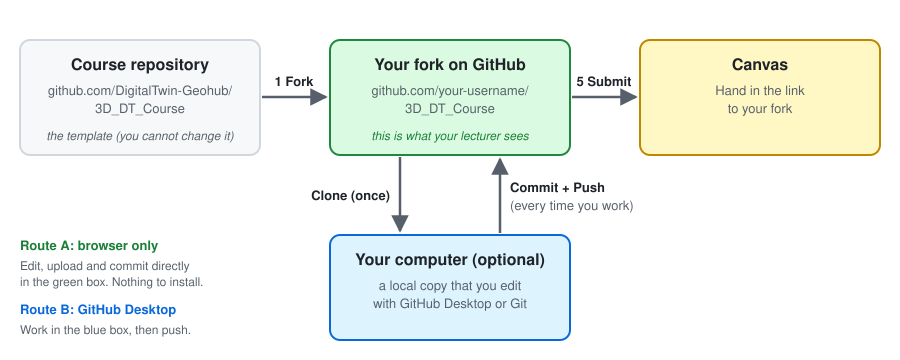

# 3D Modelling for City Digital Twins – Student Submission

**Student name:** _your name_
**Student number:** _your number_
**Area of interest / case study:** _short title_

## How to use this repository

> **New to GitHub?** Read the step-by-step [Getting Started with GitHub guide](GITHUB_GUIDE.md). It explains every step with pictures and takes about 20 minutes. You don't need to install anything.



1. **Make your own copy (fork).** Click **Fork** at the top right of this page to copy this repository to your own GitHub account. You work in your fork from now on. You can do all your work in the browser, or download (clone) your fork to your computer with [GitHub Desktop](https://desktop.github.com/). → [Step 1 of the guide](GITHUB_GUIDE.md#step-1-fork-the-course-repository) and [Step 2](GITHUB_GUIDE.md#step-2-choose-how-you-want-to-work)
2. **Fill in the answer sheets.** Answer the midterm in [`midterm/ANSWERS.md`](midterm/ANSWERS.md), the exercises in [`midterm/EXERCISES.md`](midterm/EXERCISES.md), and the final assignment in [`final/ANSWERS.md`](final/ANSWERS.md). Replace every `_Your answer here._`, and fill in your details at the top of this README. → [Route A: edit in the browser](GITHUB_GUIDE.md#a1-edit-an-answer-sheet)
3. **Add your files and show them in your answers.** Put screenshots, models, data and code in the [folders below](#folder-structure). Then link or embed them in your answer sheet with a relative path, e.g. ``. → [Step 3: Link and embed your files](GITHUB_GUIDE.md#step-3-link-and-embed-your-files)
4. **Commit (and push) regularly.** A commit saves a version of your work on GitHub. If you work on your computer, you also need to push to send your commits to GitHub. Your lecturer only sees what is on GitHub. → [Step 4](GITHUB_GUIDE.md#step-4-commit-and-push-regularly)
5. **Submit the link.** Hand in the link to your fork (`https://github.com/your-username/3D_DT_Course`) in Canvas. Check that the link opens in a private browser window without logging in. If your repository is private, give your lecturer access instead. → [Step 5](GITHUB_GUIDE.md#step-5-submit-your-link-in-canvas) and [Keep your work private](GITHUB_GUIDE.md#extra-keep-your-work-private)

## Folder structure

```text
.
├── README.md                  This file: your details and how to use the template
├── Instructions.md            Assignment instructions
├── midterm/
│   ├── ANSWERS.md             Midterm answer sheet
│   ├── EXERCISES.md           Exercises answer sheet (results and reflections)
│   └── figures/               Flowchart, UI mockup and other images
│       ├── track-a/           Exercise screenshots and output files for Track A
│       └── track-b/           Exercise screenshots and output files for Track B
└── final/
    ├── ANSWERS.md             Final assignment answer sheet
    ├── data/
    │   ├── README.md          List of all data sources and links
    │   ├── raw/               Original data, unchanged
    │   └── processed/         Data you cleaned, converted or derived
    ├── code/                  Scripts and notebooks
    ├── models/                3D model files (e.g. .glb, .obj, .gltf, CityJSON, .blend)
    └── media/
        ├── screenshots/       Screenshots of your results
        └── video/             Video of your final visualization
```

You can deliver your digital twin as code, model files or both. Leave the unused folder empty.

## Large files

GitHub rejects files over 100 MB. For larger files, do one of the following:

- Add the download link to [`final/data/README.md`](final/data/README.md), or the hosting link to your answer sheet (e.g. a video on YouTube or a model on Zenodo or SURFdrive).
- Use [Git LFS](https://git-lfs.com/).

Check that you are allowed to share proprietary data before you commit it. If you are not, describe the data and how to access it instead.
